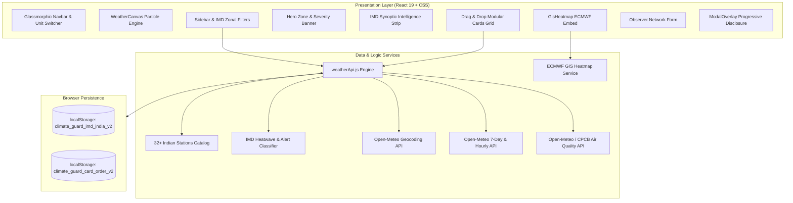

# Climate Guard — Project Context & Architecture Documentation

**Project Name:** Climate Guard / Climate Intelligence AI – Smart Heatwave Monitoring and Early Warning Dashboard  
**Use Case ID:** `KJS-CES-01`  
**Collaborating Institution:** India Meteorological Department (IMD), Mumbai-Pune  
**Domain Vertical:** Climate, Energy, & Sustainability  
**Target Beneficiaries:** Disaster Management Authorities (SDMAs/NDMA), Municipal Corporations, Public Health Agencies, Agricultural Sector, Vulnerable Citizens  
**Repository Path:** `/climate-monitoring`

---

## 1. Executive Summary

**Climate Guard** is an AI-powered meteorological intelligence and heatwave early warning web dashboard built with **React 19**, **Vite**, and modern glassmorphic web standards. The platform transitions weather forecasting from isolated point-city readings into a structured, IMD-aligned climatological intelligence system.

It features live synoptic telemetry ingestion via Open-Meteo and Central Pollution Control Board (CPCB) endpoints, automated IMD heatwave departure evaluation ($\Delta T$ against 30-year climatological normals), interactive ECMWF GIS thermal mapping, a dynamic HTML5 weather canvas animation engine, drag-and-drop card prioritization, and a field observer network.

---

## 2. IMD Domain Logic & Meteorological Rules

The system implements official **India Meteorological Department (IMD)** criteria and Indian climatological standards:

### 2.1 The 7 IMD Zonal Regions
1. **Northwest India (`northwest` / `NWI`):** Delhi NCR, Rajasthan, Punjab, Haryana, Uttar Pradesh
2. **Central India (`central` / `CI`):** Madhya Pradesh, Chhattisgarh, Vidarbha (Maharashtra core heatwave belt)
3. **East & Northeast India (`east-northeast` / `ENE`):** West Bengal, Bihar, Jharkhand, Odisha, Assam, Brahmaputra basin
4. **Western Himalayan Region (`western-himalayas` / `WHR`):** Himachal Pradesh, Uttarakhand, Jammu & Kashmir, Ladakh
5. **West Coast / Konkan & Goa (`west-coast` / `WC`):** Mumbai, Pune (Western Ghats), Goa, Surat, Ratnagiri
6. **East Coast (`east-coast` / `EC`):** Chennai (Coromandel), Visakhapatnam, Coastal Odisha
7. **South Interior Peninsula (`south-interior` / `SIP`):** Bengaluru (Deccan), Hyderabad, Vijayawada, Madurai

### 2.2 IMD Climatic Seasons
- **Pre-Monsoon / Summer (March – May):** Active Heatwave Window (`isHeatwaveSeason: true`)
- **Southwest Monsoon (June – September):** High Inundation & Precipitation Watch Window
- **Post-Monsoon / Autumn (October – December):** Cyclonic & Convective Window
- **Winter (January – February):** Cold Wave Monitoring

### 2.3 Official IMD Heatwave Classification Engine
The engine computes departure ($\Delta T = \text{Observed Max} - \text{30-Yr Normal Max}$) and applies terrain-specific rules:

| Terrain Category | Heatwave Threshold (Orange Alert) | Severe Heatwave Threshold (Red Alert) |
| :--- | :--- | :--- |
| **Plains** | Max Temp $\ge 40.0^\circ\text{C}$ AND Departure $+4.5^\circ\text{C}$ to $+6.4^\circ\text{C}$ (or absolute $\ge 45.0^\circ\text{C}$) | Departure $> +6.4^\circ\text{C}$ (or absolute $\ge 47.0^\circ\text{C}$) |
| **Coastal** | Max Temp $\ge 37.0^\circ\text{C}$ AND Departure $\ge +4.5^\circ\text{C}$ | Departure $> +6.4^\circ\text{C}$ AND Max Temp $\ge 37.0^\circ\text{C}$ |
| **Hilly Regions** | Max Temp $\ge 30.0^\circ\text{C}$ AND Departure $\ge +4.5^\circ\text{C}$ | Departure $> +6.4^\circ\text{C}$ AND Max Temp $\ge 30.0^\circ\text{C}$ |

*(If departure is $+3.0^\circ\text{C}$ to $+4.4^\circ\text{C}$, the system triggers an **IMD Yellow Watch**).*

---

## 3. System Architecture & Tech Stack



### 3.1 Technology Matrix
- **Framework:** React `19.2.7`
- **Build Tooling:** Vite `8.2.1`
- **Routing:** React Router DOM `7.18.2`
- **Mapping & GIS:** Leaflet `1.9.4` + ECMWF GIS Tile/Embed Service
- **Styling:** Custom Vanilla CSS Design System with backdrop blur, glassmorphism, responsive grid, and custom CSS variables
- **External Data Providers:**
  - Open-Meteo Forecast API (`api.open-meteo.com/v1/forecast`)
  - Open-Meteo Air Quality API (`air-quality-api.open-meteo.com/v1/air-quality`)
  - Open-Meteo Geocoding API (`geocoding-api.open-meteo.com/v1/search`)
  - ECMWF / Windy GIS Heatmap Tile Server (`embed.windy.com`)

---

## 4. Directory & File Structure

```
climate-monitoring/
├── index.html                                    # Application HTML wrapper with viewport configs
├── package.json                                  # NPM dependencies & scripts
├── vite.config.js                                # Vite bundler configuration
├── eslint.config.js                              # ESLint rules
├── README.md                                     # Project readme
│
├── src/
│   ├── main.jsx                                  # Entry point wrapping App in React.StrictMode & BrowserRouter
│   ├── index.css                                 # Root base style reset
│   ├── App.jsx                                   # Central dashboard coordinator, layout, drag & drop, routing
│   ├── App.css                                   # Main dashboard glassmorphic CSS rules
│   │
│   ├── components/
│   │   ├── GisHeatmap.jsx                        # ECMWF High-res GIS thermal heatmap with multi-layer switcher
│   │   ├── Sidebar.jsx                           # Collapsible sidebar, IMD zonal filter pills, city search
│   │   ├── WeatherCanvas.jsx                     # Full-bleed HTML5 Canvas particle & dynamic sky gradient engine
│   │   └── ModalOverlay.jsx                      # Progressive disclosure popup for IMD baseline & criteria rules
│   │
│   ├── form/
│   │   ├── userform.jsx                          # Field Observer registration & ground telemetry submission form
│   │   └── form.css                              # Observer form styling & responsive inputs
│   │
│   ├── pages/
│   │   ├── AboutPage.jsx                         # Informational routes (About, Team, Company, Contact)
│   │   └── AboutPage.css                         # About & Contact page styling
│   │
│   └── services/
│       └── weatherApi.js                         # Core IMD catalog, classification engine, REST API fetchers
│
├── new ui/                                       # macOS Weather blueprint reference & standalone prototype
│   ├── design.md                                 # Reverse-engineered design specification
│   ├── index.html                                # Standalone demo HTML
│   ├── styles.css                                # Standalone demo styling
│   └── app.js                                    # Standalone demo JS
│
└── public/                                       # Static assets (favicons, SVGs)
```

---

## 5. Component Breakdown & Key Features

### 5.1 `App.jsx` (Core Controller)
- **State Management:**
  - `locationsList`: Array of all monitored Indian stations with live telemetry.
  - `activeLocationId`: Currently focused station (defaults to `'mumbai'`).
  - `selectedImdRegion`: Active IMD zonal filter (`'all'`, `'northwest'`, `'central'`, etc.).
  - `cardOrder`: Array of card IDs supporting drag-and-drop rearrangement with localStorage persistence.
  - `unit`: Temperature unit state (`'C'` or `'F'`).
  - `isSidebarCollapsed`: Responsive sidebar toggle (auto-collapses on screens `< 768px`).
  - `userData`: Registered field observer state.
- **Drag-and-Drop Card Grid:** 13 modular dashboard cards with 6-dot drag handles, drop target indicators, and customizable priority order.
- **Routing Setup:**
  - `/` &rarr; Main IMD Heatwave Dashboard
  - `/observer-form` &rarr; Field Observer Report Form
  - `/about` &rarr; About Climate Guard (with `/team` and `/company` nested routes)
  - `/contact` &rarr; 24/7 Helpdesk & Station Support

### 5.2 `weatherApi.js` (Meteorological Brain)
- **`INDIAN_STATIONS_CATALOG`:** Pre-configured 32+ major synoptic stations across India with baseline coordinates, elevations, terrain types, and 30-year normal maximum temperatures ($T_{\text{norm}}$).
- **`classifyImdHeatwave(maxTemp, normalTemp, terrain)`:** Real-time IMD alert level computation (Normal, Heat Watch, Heatwave, Severe Heatwave).
- **`generateLiveAlert(temp, windSpeed, precip, aqiVal, wmoCode, normalTemp, terrain)`:** Priority evaluator factoring in heatwave anomalies, gale force squalls, severe convective thunderstorms, and CPCB hazardous AQI spikes.
- **`fetchLiveWeatherData(lat, lon, cityName, ...)`:** Async pipeline querying Open-Meteo hourly, daily, current, and air quality endpoints, parsing WMO weather codes, and computing dew point and apparent heat indices.
- **`searchGeocodingCities(query)`:** Debounced query handler searching Open-Meteo geocoding filtered for India (`country_code=in`) and automatically assigning IMD regional zones based on geographical boundaries.

### 5.3 `WeatherCanvas.jsx` (Dynamic Background Engine)
- Renders a full-bleed 60 FPS HTML5 canvas behind all translucent glass cards.
- **Dynamic Sky Temperature Gradients:** Interpolates between fiery copper/amber ($>35^\circ\text{C}$), warm indigo/sapphire ($26-35^\circ\text{C}$), oceanic blue ($18-25^\circ\text{C}$), and glacial cyan ($<18^\circ\text{C}$).
- **Particle Systems:**
  - Rain streaks with velocity and density proportional to weather severity (drizzle vs. downpour).
  - Ambient drifting cumulus clouds.
  - Solar radiating light beams during clear sky conditions.
  - Periodic lightning flash pulses during convective thunderstorms.

### 5.4 `GisHeatmap.jsx` (ECMWF Spatial Radar)
- Embedded high-resolution ECMWF numerical weather model centered on the active station at $11\times$ urban zoom.
- **Interactive Layer Switcher:**
  - `LST THERMAL`: Land Surface Temperature heatmap
  - `HEAT INDEX`: Apparent Heat Index & humidity stress
  - `SURFACE WIND`: Wind streamlines & thermal dispersion
  - `SATELLITE IR`: Real-time satellite infrared radiance
  - `RADAR RAIN`: Doppler precipitation radar

### 5.5 `Sidebar.jsx` (Station Navigator & Zonal Filtering)
- **7-Region Filter Pills:** Instant filtering with live station counts per IMD zone.
- **Debounced Geocoding Search:** Search and add any Indian district/city to the monitoring list.
- **Live Status Dots:** Color-coded indicators reflecting real-time station alert levels (Red = Severe Heatwave, Orange = Heatwave, Yellow = Watch, Green = Normal).
- **Keyboard Shortcut:** `⌘S` / `Ctrl+S` to toggle sidebar collapse.

### 5.6 `userform.jsx` (Observer Network Form)
- Validated submission interface for local authorities, researchers, and citizens.
- Collects micro-climate ground observations:
  - Thermal comfort scale (1: Pleasant &rarr; 5: Unbearable Heat)
  - Perceived air quality impact
  - User-configurable heat alert threshold ($^\circ\text{C}$) and AQI threshold
  - Multi-channel notification preferences (Banner alerts, Email, Daily digest)
- Automatically registers the observer on the dashboard and sets their location as active.

### 5.7 `ModalOverlay.jsx` (Progressive Disclosure)
- Detailed breakdown popups accessible by clicking any dashboard card.
- Displays the official IMD heatwave criteria reference table, 30-year normal comparisons, observed departures, and data provenance links (IMD Pune Gridded Dataset).

---

## 6. Data Models & State Structures

### Station Location Object Schema
```javascript
{
  id: "mumbai",
  name: "Mumbai",
  state: "Maharashtra",
  eyebrow: "WEST COAST / KONKAN · COASTAL",
  lat: 19.0760,
  lon: 72.8777,
  region: "west-coast",
  regionName: "West Coast / Konkan & Goa",
  imdRegion: "west-coast",
  imdRegionName: "West Coast / Konkan & Goa",
  terrain: "coastal",             // 'plains' | 'coastal' | 'hilly'
  normalMax: 33.5,                // 30-year climatological normal maximum (°C)
  elevation: "14m",
  departure: 2.1,                 // Observed Max - normalMax
  departureStr: "+2.1°C",
  climaticSeason: "Pre-Monsoon / Summer",
  time: "15:30",
  temp: 36,
  condition: "Clear Sky & Bright Sunshine",
  hl: "H: 36° · L: 28°",
  weatherState: "sunny",          // 'sunny' | 'cloudy' | 'rain' | 'drizzle' | 'thunderstorm'
  alert: {
    category: "HEATWAVE",
    severity: "warning",          // 'extreme' | 'warning' | 'watch' | 'advisory'
    colorAlert: "orange",         // 'red' | 'orange' | 'yellow' | 'green'
    badge: "IMD ORANGE ALERT · HEATWAVE",
    title: "IMD HEATWAVE ADVISORY",
    body: "Ambient maximum temperature reaching 36°C (+2.1°C departure)...",
    action: "View Cooling Shelters",
    departure: 2.1,
    departureStr: "+2.1°C",
    normalTemp: 33.5,
    terrain: "coastal"
  },
  aqi: { val: 84, status: "Moderate Air Quality", desc: "...", marker: "40%" },
  wind: { speed: "14 km/h", dirText: "Live Wind · Angle 210°", angle: 210 },
  uv: { val: 9, desc: "Very High UV level...", marker: "80%" },
  sunset: { time: "18:45", sunrise: "Sunrise tomorrow: 06:12" },
  feelsLike: { val: "41°", desc: "Relative humidity is 68%, heat index at 41°C." },
  precip: { val: "0 mm", desc: "Precipitation rate of 0mm..." },
  humidity: { val: "68%", dew: "The dew point is 24° right now." },
  visibility: { val: "7.5 km", valMiles: "4.7 mi", desc: "..." },
  pressure: { val: "1009 hPa", desc: "IMD Barometric surface pressure." },
  hourly: [ /* 24 hourly forecast slots */ ],
  tenDay: [ /* 7 daily forecast rows with temperature range bar markers */ ],
  isLive: true
}
```

---

## 7. Local Storage & Persistence Keys

| Key Name | Purpose | Data Type |
| :--- | :--- | :--- |
| `climate_guard_imd_india_v2` | Cached array of Indian stations and recent live API sync telemetry | JSON Array of Station Objects |
| `climate_guard_card_order_v2` | User-defined priority order of dashboard cards (drag-and-drop arrangement) | JSON Array of String IDs |

---

## 8. Development & Operational Guide

### 8.1 Setup and Running Locally
```bash
# Install dependencies
npm install

# Start Vite development server
npm run dev

# Build production bundle
npm run build

# Preview production build
npm run preview

# Run ESLint validation
npm run lint
```

### 8.2 Adding New IMD Stations
To add a new station to the catalog, update `INDIAN_STATIONS_CATALOG` in `src/services/weatherApi.js`:
```javascript
{
  id: 'nagpur',
  name: 'Nagpur',
  state: 'Maharashtra (Vidarbha)',
  region: 'central',
  regionName: 'Central India / Vidarbha',
  terrain: 'plains',
  lat: 21.1458,
  lon: 79.0882,
  normalMax: 42.0,
  elevation: '310m'
}
```

---

## 9. Future Roadmap & Project Phases

- **Phase 1 (IMD Data Pipeline):** Direct ingestion of IMD Pune binary `.GRD` 0.5° × 0.5° spatial temperature datasets for multi-decade historical trends.
- **Phase 2 (AI Prediction Engine):** Machine learning models (e.g., LSTM/XGBoost) for 1–5 day heatwave onset and duration forecasting.
- **Phase 3 (Socio-Economic Vulnerability Index):** Overlaying urban heat island (UHI) hotspots with population density, slum settlements, and outdoor laborer density.
- **Phase 4 (Advanced GIS Raster Heatmaps):** Continuous temperature raster contour interpolation across India with an interactive 1–5 day temporal slider.
